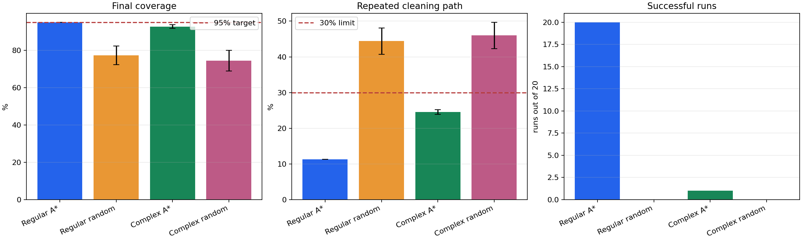
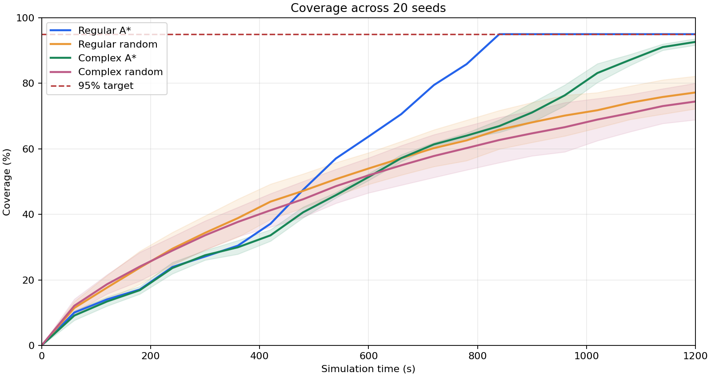
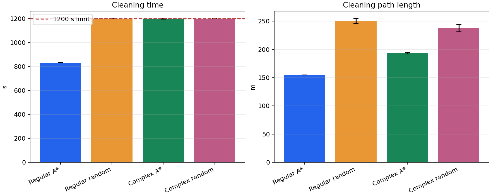
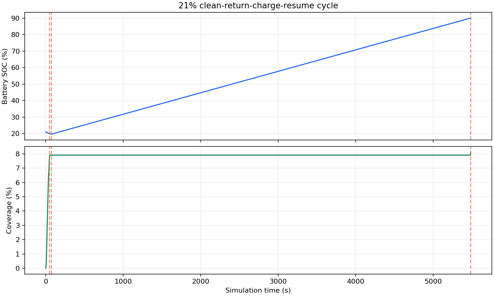
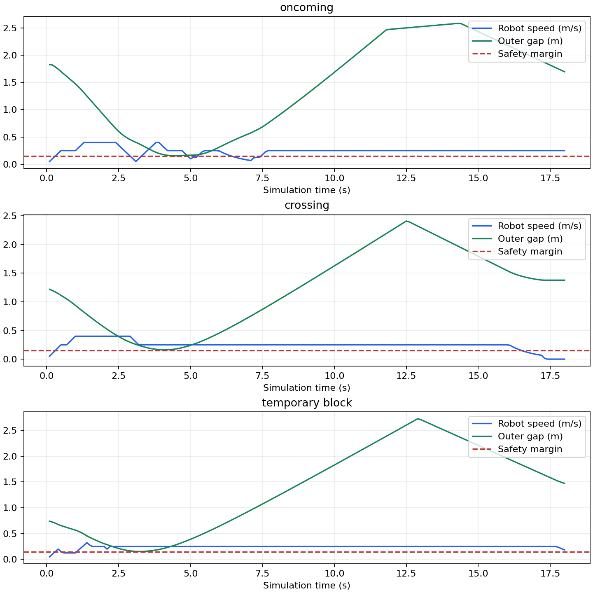

# 清扫算法重复实验记录

## 条件与判据

- 两个场景 × 两种算法 × 20个种子，共80次；种子0—19，同一场景的两种算法使用同一组种子。
- 初始电量100%，起点(0.5, 0.5) m，朝向0°，步长0.1 s，清扫阶段上限1200 s。
- 成功定义：覆盖率≥95%、无实体碰撞、清扫阶段≤1200 s，且控制器完成返站。路径重复率与0.15 m安全间距分别统计。
- 路径重复率按0.1 m轨迹格统计：离开后再次进入同格的清扫移动距离 / 清扫总移动距离；返航距离不计入分母。短步轨迹在格边界处分段计长。
- 每次结果均保留，失败样本也参与均值与标准差。完整参数及源码SHA-256见 `manifest.json`。

## 结果

| 场景 | 算法 | 成功次数 | 覆盖率均值±标准差 | 清扫时间均值±标准差(s) | 清扫路程均值±标准差(m) | 重复率均值±标准差 | 安全间距达标 | 碰撞运行数 |
| --- | --- | ---: | ---: | ---: | ---: | ---: | ---: | ---: |
| 规则 | 弓字形+A* | 20/20 | 95.00±0.00% | 831.8±0.0 | 154.8±0.0 | 11.3±0.0% | 20/20 | 0 |
| 规则 | 随机反弹 | 0/20 | 77.20±4.99% | 1200.0±0.0 | 250.7±4.4 | 44.4±3.7% | 20/20 | 0 |
| 复杂 | 弓字形+A* | 1/20 | 92.64±0.98% | 1199.1±4.1 | 193.2±1.6 | 24.6±0.7% | 20/20 | 0 |
| 复杂 | 随机反弹 | 0/20 | 74.44±5.58% | 1200.0±0.0 | 237.8±6.5 | 46.0±3.7% | 16/20 | 0 |

## 返航专项（另60次）

复杂场景、弓字形+A*、初始朝向0°，各电量使用种子0—19。返航成功严格按“无碰撞、停靠误差≤0.10 m、速度≤0.02 m/s、电量连续上升5个仿真步”判定，所有失败样本参与统计。

| 初始电量 | 返航成功 | 触发返航 | 完成清扫返站但未充电 | 清扫超时失败 | 触发电量均值 | 停靠并充电时间均值 |
| ---: | ---: | ---: | ---: | ---: | ---: | ---: |
| 80% | 0/20 | 1/20 | 1/20 | 19/20 | 56.25%（仅1次） | 不适用 |
| 40% | 20/20 | 20/20 | 0 | 0 | 20.00% | 1039.8 s |
| 20% | 20/20 | 20/20 | 0 | 0 | 20.00% | 0.5 s |

80%组中19次先达到清扫阶段1200 s上限，因而没有进入低电量返航；另1次覆盖率达到95%后返站，但控制逻辑按已完成任务结束，没有启动充电。这组结果不能作为高电量条件下“充电返航可靠”的证据，也不应与40%、20%组合并成一个成功率。详见 [返航汇总](../return_results/summary.csv)、[逐次结果](../return_results/runs)和 [完整日志](../return_results/logs)。

另以21%初始电量、种子7验证一次完整闭环：46.3 s触发返航，69.2 s开始充电，5481.7 s恢复清扫，覆盖率由充电时7.907%继续升至8.108%，无碰撞。充电期间每0.1 s仍执行世界更新；仅在行人距充电站超过1.2 m时跳过不改变充电指令的预测计算。见 [闭环结果](../closed_loop_results/result.json)与下图。

## 模型、空间与避障专项

直行、原地旋转、圆弧运动与解析差速运动轨迹的位置误差均小于10⁻⁶ m，制动减速度0.5 m/s²时从0.25 m/s在0.5 s内停止。L形隔断上方净宽0.8 m，中心可通行且A*能到达；障碍物内部目标被明确拒绝。

受控开阔房间中的迎面行人、横穿行人和短时挡路后移开三种情形均出现避让后恢复清扫，碰撞0次，最小外缘间距分别为0.1538、0.1623、0.1534 m。这些是专项功能验证；复杂场景全程安全性仍以80次对比日志为准。见 [验证数值](../validation_results/report.json)和下图。

## 结论与限制

规则场景的主方案达到95%覆盖、≤30%重复率和零碰撞。复杂场景的主方案仅1/20次达到95%，其余19次因1200 s清扫上限而失败；下一步需提升复杂场景补扫效率。随机基线在两个场景均未达到95%，且重复率超过30%。复杂随机有4/20次最小外缘间距低于0.15 m，虽未发生实体碰撞，仍不满足安全间距要求。

规则场景没有动态障碍，覆盖方案是确定性的，因此20次重复结果完全相同。复杂场景当前行人初始化只有两个方向随机选择，20个种子实际只产生4类行人初始运动组合；这些结果不能视为充分多样的动态扰动。复杂场景覆盖率仍需改进，80%组的返航测试也未能充分触发低电量条件。

## 文件

- `summary.csv` / `summary.json`：每组均值、样本标准差、成功次数和安全指标。
- `runs/*.json`：每次运行的最终指标和失败原因。
- `events/*.json`：碰撞、状态切换、返航及充电等事件。
- `logs/*.csv.gz`：每次运行完整逐步记录，包含时间、位置、速度、电量、覆盖率、阶段和逐步路程。
